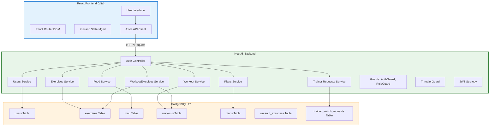

# PROJECT_PRESENTATION.md

## 1. Project Overview

**GymManagerApp** is a full-stack application for managing gym operations. It centralizes member data, workout tracking, nutrition monitoring, and training plan management into a single platform.

**Problem solved:**
- Replaces manual tracking of workouts, nutrition, and member progress
- Enables systematic organization of gym data for trainers and administrators
- Facilitates trainer-client relationship management

**Intended users:**
- Gym members (can view their own data and track progress)
- Trainers (can manage client assignments, create workouts and plans)
- Administrators (have full system access and oversight)

**Main purpose:**
Provide a unified system for gym management that streamlines workflows between trainers and clients while giving administrators complete oversight of all operations.

**Overall workflow:**
1. User registers or logs in with email/phone and password
2. Authentication generates access and refresh tokens
3. Authenticated user accesses role-appropriate features
4. Frontend communicates with backend API for all operations
5. Backend processes requests, validates data, and interacts with PostgreSQL database
6. Data is persisted with proper relationships and constraints

## 2. Technology Stack

**Frontend:**
- React v19 + Vite
- React Router DOM for client-side routing
- Axios for API communication
- Zustand for state management
- Tailwind CSS v4 for styling
- Lucide React for icons
- React Hook Form with Yup validation

**Backend:**
- NestJS v11 framework
- TypeORM for database operations
- PostgreSQL 17 as the database
- bcryptjs for password hashing (8 rounds)
- class-validator and class-transformer for DTO validation
- @nestjs/jwt for JWT authentication
- @nestjs/throttler for rate limiting
- Swagger/OpenAPI for documentation

**Tools & Infrastructure:**
- Docker for containerization
- Docker Compose v2 for orchestration
- Jest for testing
- Git for version control

## 3. Application Architecture

The application follows a client-server architecture with three distinct layers:

**Request/Response Flow:**
1. User interacts with UI → React components update state via Zustand
2. Form submissions send data via Axios to backend API
3. NestJS controllers receive requests and delegate to services
4. Services validate DTOs, interact with TypeORM repositories
5. TypeORM generates SQL queries for PostgreSQL
6. Responses flow back through the same path

## 4. Main Features

**Authentication & Authorization:**
- Two-phase authentication: access token (40min TTL) + refresh token (7d TTL)
- JWT tokens contain userId and role in payload
- Passwords hashed with bcrypt (8 rounds)
- Role-based access control using NestJS guards (@Roles decorator)
- AuthGuard and RoleGuard for protected routes

**User Management:**
- Register/login with email, phone, password
- Profile management (first name, last name, birth date, gender, height, weight)
- Role assignment: USER or TRAINER
- Unique constraints on email and phone number

**Workout Management:**
- Create, read, update, and delete workouts
- Workouts contain multiple exercises via workout_exercises junction table
- Assign workouts to specific clients
- Remove workouts from clients (nullifies trainer reference)
- Get today's workouts and weekly workouts

**Exercise Management:**
- Create, read, update, and delete exercises
- Exercises have name, muscle group, and target type
- Filter exercises by muscle group (ILIKE search)
- Retrieve exercises by trainer

**Food & Nutrition Tracking:**
- Log food entries with calories, protein, carbs, fats
- Retrieve today's nutrition summary
- Get total daily calories, protein, carbs, fats
- Food entries associated with user

**Training Plans:**
- Create and manage training plans with start/end dates
- Assign plans to clients
- Find user's plans and active plans (based on date check)
- Remove plans from clients

**Trainer-Client Management:**
- Send trainer requests (validation: not self, trainer exists, no pending, not already assigned)
- View pending trainer requests (filter by trainer/admin)
- Decide on trainer requests (authorization check)
- View trainer's clients and trainer's own profile
- Remove client (nullifies trainer reference)

## 5. Database Overview

**Database:** PostgreSQL 17 via Docker

**Main Tables:**

| Table | Key Columns | Constraints |
|-------|------------|-------------|
| users | id, email, password, phone, role, createdAt | UNIQUE(email), UNIQUE(phone), CHECK(role IN ('USER','TRAINER')) |
| exercises | id, name, muscleGroup, createdBy | UNIQUE(name), FK to users |
| food | id, name, calories, protein, carbs, fats, userId | FK to users |
| workouts | id, title, description, durationMinutes, createdBy | FK to users |
| plans | id, title, startDate, endDate, userId | FK to users |
| workout_exercises | id, workoutId, exerciseId, sets, reps | PK composite, FK to workouts & exercises |
| trainer_switch_requests | id, requesterId, trainerId, status, decidedAt | FK to users, status ENUM |

**TypeORM Usage:**
- Entity classes decorate @Entity() with @Column(), @PrimaryKey()
- Relationships: User(1)-(*)Food, User(1)-(*)Plans, User(1)-(*)Workouts, User(*)-(*)User (trainer/clients)
- Cascade behaviors defined on relationships
- Idempotent seed data with INSERT ... WHERE NOT EXISTS pattern

**Key Constraints:**
- UNIQUE on email and phone in users table
- CHECK on role column (only 'USER' or 'TRAINER')
- Foreign key relationships with proper referential integrity
- WHERE NOT EXISTS for idempotent initialization

## 6. Docker: Normal Mode vs Development Mode

**Normal Mode (docker-compose.yaml):**
- db: PostgreSQL 17 container with volume `gymmanager-data-normal`
- seed: One-time execution of init.sql (node:20-alpine), runs once then stops
- backend: NestJS container with production dockerfile, depends on db + seed
- frontend: Vite React container, VITE_API_URL=http://localhost:3000/api, depends on backend

**Development Mode (docker-compose.dev.yaml):**
- db: Same PostgreSQL 17 container
- backend: Container with dockerfile.dev, volume mounts `./server:/app` and `/app/node_modules` for hot reload, depends on db
- frontend: Container with dockerfile.dev, volume mounts `./client:/app` and `/app/node_modules` for hot reload, depends on backend

**Key Differences:**
- Normal mode: Static build, no volume mounts, production-ready
- Dev mode: Hot reload enabled, source code mounted live, faster iteration
- Both modes have independent Compose files (no profiles, no anchors, no shared config)
- Dev mode enables rapid development with immediate feedback on code changes

## 7. Conclusion and Future Improvements

**Main Value:**
GymManagerApp centralizes gym operations into a unified platform, replacing manual tracking systems. It provides trainers and administrators with powerful tools to manage members, workouts, nutrition, and training plans efficiently.

**Realistic Improvements:**
- Integration with wearable devices for automatic workout tracking
- Advanced analytics and progress visualization charts
- Email notifications for plan milestones and upcoming sessions
- Payment integration for premium features
- Advanced filtering and search across all entity types
- Admin dashboard with system-wide metrics and reports

